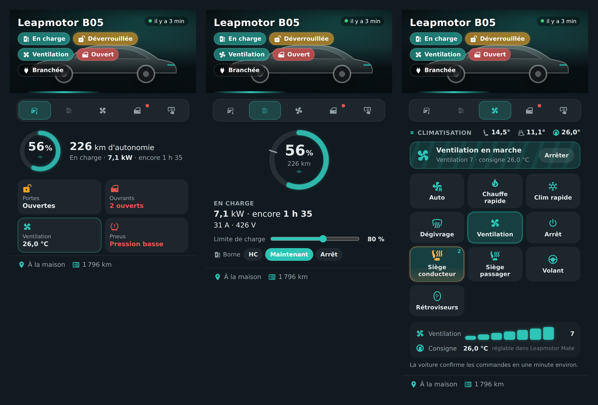
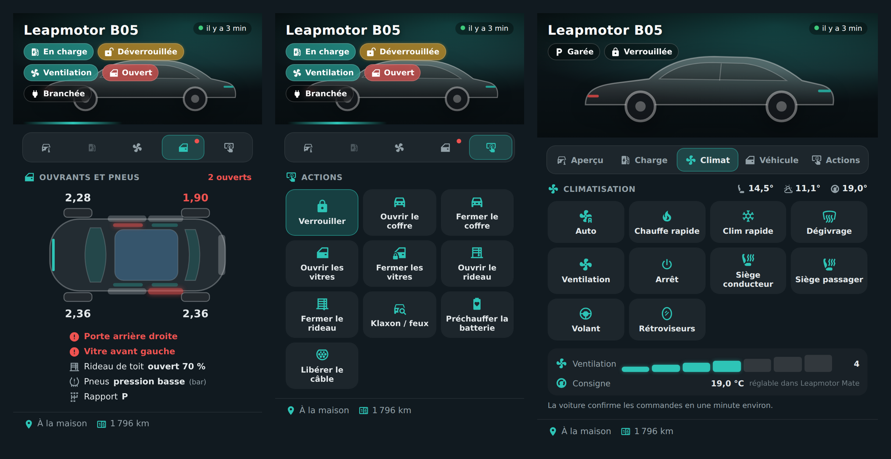

# 🚗 HOLM Leapmotor Card

[](https://hacs.xyz/)


[🇫🇷 Français](README.md) · 🇬🇧 English

**Your Leapmotor in Home Assistant: battery, charging, air conditioning, openings, tyres, actions and location — with a photo of your car.**

HOLM Leapmotor Card relies on the **[Leapmotor Mate](https://github.com/ProtossBlaster/leapmotor-mate)** add-on (MQTT publishing to Home Assistant). It finds your car's entities on its own and groups them in a tabbed card, with animations while charging or air conditioning is running.

> ✨ **Nothing to configure.** Add the card and it detects your car. Everything else is set in the visual editor.

### At a glance

- 🖼️ **Your photo** (Home Assistant media library or an image address), or a default silhouette, with the status at a glance: charging, locked, air conditioning, openings.
- 🗺️ **Overview**: battery, range, charging status, doors, openings, air conditioning, tyres, and a **mini map** of the location.
- 🔌 **Charge**: battery ring with the **charge limit** mark (adjustable), power, current, time remaining. With [HOLM Lektrico](https://github.com/kaaribou/lektrico-holm), the charger modes (off-peak, now, stop) are right in the card.
- ❄️ **Climate**: auto, quick heat, quick cool, defrost, ventilation, heated seats, steering wheel, mirrors, **fan speed**. The running function is animated, and a **Stop** button is always at hand.
- 🚪 **Vehicle**: top view with open doors, windows and boot in red, pressure of the four tyres with an alert.
- 🔒 **Actions**: lock, boot, windows, sunshade, horn / lights, battery preheating, cable release. Sensitive actions ask for **a second tap** to confirm.
- 🌍 **8 languages**: English, French, German, Spanish, Italian, Dutch, Portuguese and Polish.





*Screenshots in French — the card follows the language of your Home Assistant profile.*

### 🆕 What's new in 1.1.0

- 🌍 **The card speaks 8 languages**: English, French, German, Spanish, Italian, Dutch, Portuguese and Polish, editor included. It follows the language of your Home Assistant profile (English if your language isn't translated yet); the `language` option lets you force one. Numbers follow the language too.

---

## Requirements

- The **Leapmotor Mate** add-on installed and connected to your Leapmotor account.
- In Leapmotor Mate, **MQTT → Home Assistant** enabled (automatic discovery), linked to Home Assistant's MQTT broker (Mosquitto).

## Installation

### With HACS (recommended)

1. HACS → ⋮ menu → **Custom repositories**.
2. Add `https://github.com/kaaribou/holm-leapmotor-card`, category **Dashboard** (*Plugin*).
3. Search for the card → **Download**.
4. Reload the page (Ctrl + F5).

### Manually

1. Copy `dist/holm-leapmotor-card.js` to `config/www/community/holm-leapmotor-card/`.
2. **Settings → Dashboards → ⋮ → Resources → Add**: `/local/community/holm-leapmotor-card/holm-leapmotor-card.js`, type **JavaScript module**.
3. Reload the page.

---

## Usage

```yaml
type: custom:holm-leapmotor-card
name: Leapmotor B05
```

That's all: the entity prefix (`leapmotor_mate_xxxxxx`) is found automatically. If you have several cars, set it with `prefix`.

### Adding your photo

In the editor, **Photo** field: pick an image from the media library (you can upload yours there), or enter an address, for example `/local/car.jpg` (file placed in `config/www/`). A cut-out or side-view photo looks best.

### Options

| Option | Default | Description |
|---|---|---|
| `language` | the profile's | Card language: `fr`, `en`, `de`, `es`, `it`, `nl`, `pt`, `pl`. |
| `name` | — | Display name. |
| `prefix` | automatic | Leapmotor Mate entity prefix (e.g. `leapmotor_mate_002242`). |
| `image_media` / `image` | silhouette | Photo: media library item, or image address. |
| `default_tab` | `overview` | Tab shown on opening: `overview`, `charge`, `climate`, `body`, `actions`. |
| `show_climate` | `true` | Climate tab. |
| `show_body` | `true` | Vehicle tab (openings and tyres). |
| `show_actions` | `true` | Actions tab. |
| `show_location` | `true` | Location, mini map and mileage. |
| `show_charger` | `true` | [HOLM Lektrico](https://github.com/kaaribou/lektrico-holm) charger modes. |
| `charger_mode` | automatic | Charger mode selector (`select.*_mode_de_charge`). |
| `confirm` | `true` | Second tap to confirm sensitive actions. |
| `map_zoom` | `15` | Mini map zoom. |
| `accent` | `#2ec4b6` | Accent colour. |
| `tyre_min` | `2.1` | Tyre pressure alert below (bar). |

---

## Good to know

- **Commands are not instant.** The car has to wake up, and Leapmotor Mate polls the Leapmotor cloud at regular intervals: often allow **a minute** before the card shows the new state. Meanwhile, the button shows “Sent…”. Polling intervals are set in the Leapmotor Mate interface.
- **Temperature setpoint**: Leapmotor Mate publishes it read-only. The card shows it; it is set in Leapmotor Mate.
- **Leapmotor Mate is not an official Leapmotor tool**: its behaviour may change with the manufacturer's cloud.
- **The card is not in your language?** Set `language` in the card, or open an issue to suggest a translation.

---

## Going further with HOLM

- [HOLM Lektrico](https://github.com/kaaribou/lektrico-holm): control your Lektrico charger (off-peak hours, solar surplus…).
- [HOLM HP/HC, tariffs and subscription](https://github.com/kaaribou/holm-tarif): off-peak / peak periods and electricity prices.

---

## Say thanks?

Like the card? You can buy me a beer 🍺

[](https://paypal.me/kaaribou)

---

## License

Code: **MIT** license — © kaaribou. See the [CHANGELOG](CHANGELOG.md) (in French).

Part of **HOLM — Home Orchestration & Living Management**: smart management and orchestration of the home.

Other projects: [Carburant HOLM](https://github.com/kaaribou/carburant-holm) · [Climat HOLM](https://github.com/kaaribou/climat-holm) · [Volets HOLM](https://github.com/kaaribou/volets-holm) · [HOLM HP/HC](https://github.com/kaaribou/holm-tarif) · [HOLM Lektrico](https://github.com/kaaribou/lektrico-holm) · [HOLM LaMetric](https://github.com/kaaribou/lametric-holm) · [HOLM My Menu](https://github.com/kaaribou/holm-mymenu) · [HOLM Cars](https://github.com/kaaribou/holm-cars) · [HOLM GitHub](https://github.com/kaaribou/github-holm) · [HOLM Navbar Card](https://github.com/kaaribou/holm-navbar-card) · [HOLM Climate Card](https://github.com/kaaribou/climate-card-holm) · [HOLM Music Card](https://github.com/kaaribou/holm-music-card) · [HOLM Energy Cards](https://github.com/kaaribou/holm-energy-cards) · [HOLM Power Flow Card](https://github.com/kaaribou/holm-power-flow-card) · [HOLM Ecojoko Card](https://github.com/kaaribou/holm-ecojoko-card) · [HOLM Runtime Card](https://github.com/kaaribou/holm-runtime-card) · [HOLM Covers Card](https://github.com/kaaribou/holm-covers-card) · [HOLM Floor Card](https://github.com/kaaribou/holm-floor-card) · [HOLM Radiator Card](https://github.com/kaaribou/holm-radiator-card) · [HOLM Security Card](https://github.com/kaaribou/holm-security-card) · [HOLM Sentinel Card](https://github.com/kaaribou/holm-sentinel-card) · [HOLM Recordings Card](https://github.com/kaaribou/holm-recordings-card) · [HOLM Smoke Card](https://github.com/kaaribou/holm-smoke-card) · [HOLM Family Card](https://github.com/kaaribou/holm-family-card) · [HOLM Govee Light Card](https://github.com/kaaribou/holm-govee-light-card).
