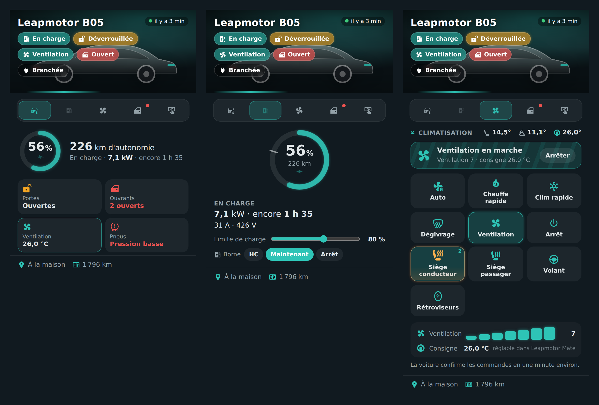
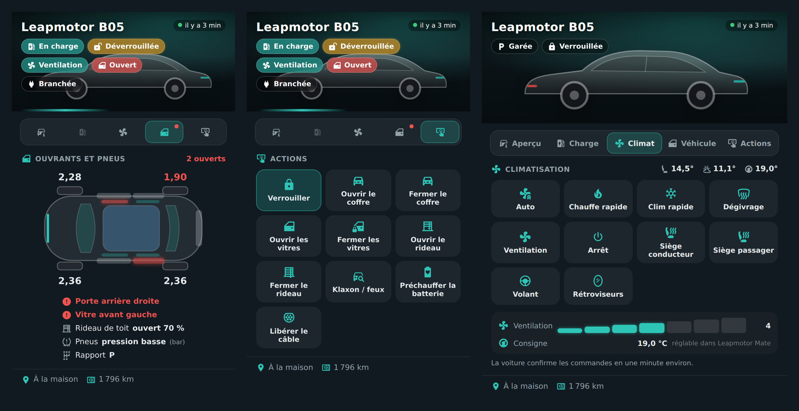

# 🚗 HOLM Leapmotor Card

[](https://hacs.xyz/)


**Votre Leapmotor dans Home Assistant : batterie, charge, climatisation, ouvrants, pneus, actions et position — avec la photo de votre voiture.**

HOLM Leapmotor Card s'appuie sur l'add-on **[Leapmotor Mate](https://github.com/ProtossBlaster/leapmotor-mate)** (publication MQTT vers Home Assistant). Elle trouve toute seule les entités de votre voiture et les regroupe dans une carte à onglets, avec des animations quand la charge ou la climatisation sont en marche.

> ✨ **Rien à configurer.** Ajoutez la carte, elle détecte votre voiture. Tout le reste se règle dans l'éditeur visuel.

### En bref

- 🖼️ **Votre photo** (médiathèque de Home Assistant ou adresse d'image), ou une silhouette par défaut, avec l'état en un coup d'œil : en charge, verrouillée, climatisation, ouvrants.
- 🗺️ **Aperçu** : batterie, autonomie, état de charge, portes, ouvrants, climatisation, pneus, et une **mini-carte** de la position.
- 🔌 **Charge** : anneau de batterie avec le repère de la **limite de charge** (réglable), puissance, courant, temps restant. Avec [HOLM Lektrico](https://github.com/kaaribou/lektrico-holm), les modes de la borne (heures creuses, maintenant, arrêt) sont directement dans la carte.
- ❄️ **Climat** : auto, chauffe rapide, clim rapide, dégivrage, ventilation, sièges chauffants, volant, rétroviseurs, **vitesse de ventilation**. La fonction en marche est animée, et un bouton **Arrêter** est toujours à portée.
- 🚪 **Véhicule** : vue de dessus avec les portes, vitres et coffre ouverts en rouge, pression des quatre pneus avec alerte.
- 🔒 **Actions** : verrouiller, coffre, vitres, rideau de toit, klaxon / feux, préchauffage de la batterie, libérer le câble. Les actions sensibles demandent **un second toucher** pour confirmer.





---

## Prérequis

- L'add-on **Leapmotor Mate** installé et connecté à votre compte Leapmotor.
- Dans Leapmotor Mate, **MQTT → Home Assistant** activé (découverte automatique), relié au broker MQTT de Home Assistant (Mosquitto).

## Installation

### Avec HACS (recommandé)

1. HACS → menu ⋮ → **Dépôts personnalisés**.
2. Ajoutez `https://github.com/kaaribou/holm-leapmotor-card`, catégorie **Tableau de bord** (*Dashboard / Plugin*).
3. Recherchez la carte → **Télécharger**.
4. Rechargez la page (Ctrl + F5).

### Manuellement

1. Copiez `dist/holm-leapmotor-card.js` dans `config/www/community/holm-leapmotor-card/`.
2. **Paramètres → Tableaux de bord → ⋮ → Ressources → Ajouter** : `/local/community/holm-leapmotor-card/holm-leapmotor-card.js`, type **Module JavaScript**.
3. Rechargez la page.

---

## Utilisation

```yaml
type: custom:holm-leapmotor-card
name: Leapmotor B05
```

C'est tout : le préfixe des entités (`leapmotor_mate_xxxxxx`) est trouvé automatiquement. Si vous avez plusieurs voitures, indiquez-le avec `prefix`.

### Ajouter votre photo

Dans l'éditeur, champ **Photo** : choisissez une image de la médiathèque (vous pouvez y téléverser la vôtre), ou indiquez une adresse, par exemple `/local/voiture.jpg` (fichier placé dans `config/www/`). Une photo détourée ou prise de profil rend le mieux.

### Options

| Option | Par défaut | Description |
|---|---|---|
| `name` | — | Nom affiché. |
| `prefix` | automatique | Préfixe des entités Leapmotor Mate (ex. `leapmotor_mate_002242`). |
| `image_media` / `image` | silhouette | Photo : média de la médiathèque, ou adresse d'image. |
| `default_tab` | `overview` | Onglet affiché à l'ouverture : `overview`, `charge`, `climate`, `body`, `actions`. |
| `show_climate` | `true` | Onglet Climat. |
| `show_body` | `true` | Onglet Véhicule (ouvrants et pneus). |
| `show_actions` | `true` | Onglet Actions. |
| `show_location` | `true` | Position, mini-carte et kilométrage. |
| `show_charger` | `true` | Modes de la borne [HOLM Lektrico](https://github.com/kaaribou/lektrico-holm). |
| `charger_mode` | automatique | Sélecteur de mode de la borne (`select.*_mode_de_charge`). |
| `confirm` | `true` | Second toucher pour confirmer les actions sensibles. |
| `map_zoom` | `15` | Zoom de la mini-carte. |
| `accent` | `#2ec4b6` | Couleur d'accent. |
| `tyre_min` | `2.1` | Alerte de pression des pneus en dessous de (bar). |

---

## Bon à savoir

- **Les commandes ne sont pas instantanées.** La voiture doit se réveiller, et Leapmotor Mate interroge le cloud Leapmotor à intervalle régulier : comptez souvent **une minute** avant que la carte affiche le nouvel état. En attendant, le bouton indique « Envoyé… ». Les intervalles d'interrogation se règlent dans l'interface de Leapmotor Mate.
- **Consigne de température** : Leapmotor Mate ne la publie qu'en lecture. La carte l'affiche ; elle se règle dans Leapmotor Mate.
- **Leapmotor Mate n'est pas un outil officiel Leapmotor** : son fonctionnement peut changer avec le cloud du constructeur.

---

## Aller plus loin avec HOLM

- [HOLM Lektrico](https://github.com/kaaribou/lektrico-holm) : pilotez votre borne Lektrico (heures creuses, surplus solaire…).
- [HOLM HP/HC, Tarification et abonnement](https://github.com/kaaribou/holm-tarif) : périodes heures creuses / pleines et prix de l'électricité.

---

## Licence

MIT — voir [LICENSE](LICENSE).

Si cette carte vous rend service : [🍺 offrez-moi une bière](https://paypal.me/kaaribou)
